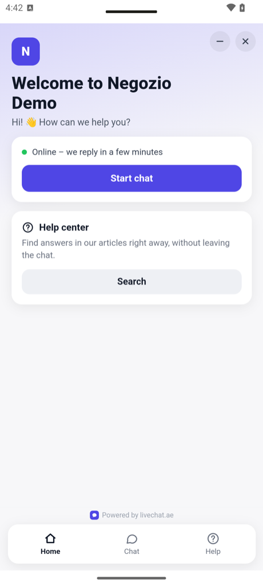
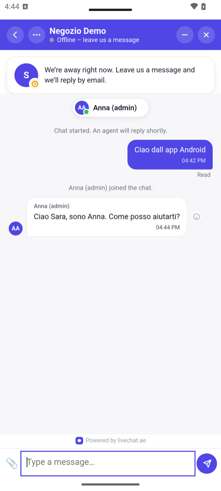
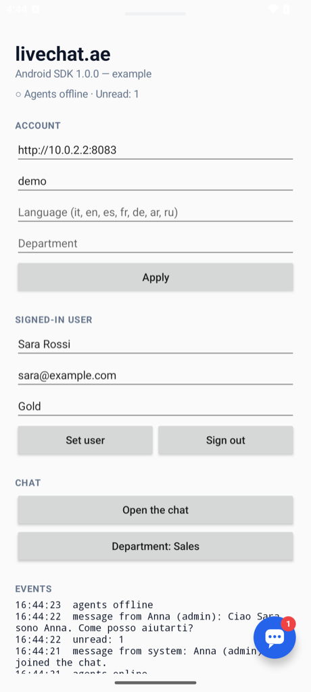

# livechat.ae Android SDK

Add the livechat.ae chat to your Android app. The users of your app chat with your team
exactly like the visitors of your website: same agents, same settings, same pre-chat and
post-chat forms, departments, languages, knowledge base, attachments and ratings.

- Kotlin and Java, Android 7.0 (API 24) or later, phones and tablets
- One line to set up, one line to open the chat, a ready-made chat button with the unread badge
- Visitor name, email, custom fields and identity token from your app
- Events: new message, unread count, chat opened and closed, conversation started and ended, errors
- Push notifications when the app is closed, sent by your server through the `chat.agent_message` webhook

<p>
  
  
  
</p>

## Requirements

- Android 7.0 (API 24) or later, with Android System WebView (or Chrome) up to date
- `compileSdk` 36 and Java 17 for building
- A livechat.ae account and its **widget key**: the same `data-key` as in the website snippet,
  in **Admin › Installation**

## Installation

The SDK is on [JitPack](https://jitpack.io). In `settings.gradle.kts`:

```kotlin
dependencyResolutionManagement {
    repositories {
        google()
        mavenCentral()
        maven("https://jitpack.io")
    }
}
```

In the `build.gradle.kts` of your app:

```kotlin
dependencies {
    implementation("com.github.gatehillsreg:livechat-android-sdk:1.0.0")
}
```

The SDK adds the `INTERNET` permission to your app. Its only dependency is `androidx.webkit`.

## Quick start

Configure the SDK once, in `Application.onCreate`. The chat loads in the background, so
messages and the unread count arrive even before the user opens it.

```kotlin
import ae.livechat.sdk.LiveChatAE

class MyApp : Application() {
    override fun onCreate() {
        super.onCreate()
        LiveChatAE.configure(this, key = "YOUR-WIDGET-KEY")
    }
}
```

Open the chat from anywhere:

```kotlin
LiveChatAE.present(activity)     // from one of your activities
LiveChatAE.present()             // or from the activity on screen
LiveChatAE.dismiss()             // close it from code
```

Or drop in the ready-made button, with the unread badge:

```kotlin
val button = LiveChatAEButton(context)   // 56×56 dp, uses the accent color of the theme (or set button.color)
layout.addView(button)
```

```xml
<ae.livechat.sdk.LiveChatAEButton
    android:layout_width="wrap_content"
    android:layout_height="wrap_content"
    android:layout_gravity="bottom|end"
    android:layout_margin="20dp" />
```

```kotlin
// Jetpack Compose
AndroidView(factory = { LiveChatAEButton(it) }, modifier = Modifier.padding(20.dp))
```

The chat opens full screen, above the keyboard and between the system bars. The user closes it
with the **–** button in its header or with the back button. The conversation goes on: new
messages keep arriving and are counted as unread.

In Java every method is static: `LiveChatAE.configure(context, "YOUR-WIDGET-KEY")`,
`LiveChatAE.present(activity)`.

## Configuration

```kotlin
LiveChatAE.configure(
    context,
    key = "YOUR-WIDGET-KEY",
    language = "it",             // it, en, es, fr, de, ar, ru. Default: your account's language, then the device's
    department = "Sales",        // department for new chats. Default: the visitor chooses
)

LiveChatAE.setDepartment("Support")   // change it later, for the next chats
```

Calling `configure` again with different values reloads the chat.

## The signed-in user

If your app knows who the user is, pass it on: the pre-chat form is filled in, and agents see
who they are talking to.

```kotlin
LiveChatAE.setVisitor(name = "Sara Rossi", email = "sara@example.com")

// shown to agents next to the chat (up to 20 fields)
LiveChatAE.setCustomFields(mapOf("plan" to "Gold", "customerId" to "C-1042"))

// identity token signed by your server (same as LiveChatAE.identify on the website):
// livechat.ae passes it to your remote (AI) agents, which verify it
LiveChatAE.identify(tokenFromYourServer)
```

When the user signs out, forget them and their conversation on this device:

```kotlin
LiveChatAE.identify(null)
LiveChatAE.reset()
```

## Events

Use a listener (every method is optional) …

```kotlin
class ChatEvents : LiveChatAEListener {
    override fun onMessage(message: LiveChatAEMessage) {
        println("${message.sender} ${message.author}: ${message.text}")
    }
    override fun onUnreadCountChanged(count: Int) { badge.text = if (count > 0) "$count" else "" }
    override fun onChatPresented() {}
    override fun onChatDismissed() {}
    override fun onChatStarted(chatId: String) {}
    override fun onChatEnded(chatId: String) {}
    override fun onAgentsOnlineChanged(online: Boolean) {}
    override fun onError(error: LiveChatAEError) { Log.w("chat", error.toString()) }
}

LiveChatAE.addListener(events)       // and removeListener(events) when it goes away, e.g. in onDestroy
```

… or lambdas:

```kotlin
LiveChatAE.onMessage = { message -> … }
LiveChatAE.onUnreadCountChange = { count -> … }
LiveChatAE.onPresent = { … }
LiveChatAE.onDismiss = { … }
LiveChatAE.onChatStarted = { chatId -> … }
LiveChatAE.onChatEnded = { chatId -> … }
LiveChatAE.onError = { error -> … }
```

Events arrive on the main thread. The current state is always there too:
`LiveChatAE.unreadCount`, `isPresented`, `agentsOnline`, `lastError`.

| Event | When |
|---|---|
| `onMessage` | A new message: from an agent, an AI agent or an automation (`AGENT`), from the visitor (`VISITOR`) or a notice (`SYSTEM`). Arrives also while the chat window is closed, as long as the app is in the foreground |
| `onUnreadCountChanged` | Agent messages not seen yet. Kept when the app is closed and opened again |
| `onChatPresented` / `onChatDismissed` | The chat window opened / closed |
| `onChatStarted` | The visitor sent the first message, reopened a closed chat, or an agent invited them |
| `onChatEnded` | The conversation was closed by the agent, the visitor or for inactivity |
| `onAgentsOnlineChanged` | Agents came online or all went offline |
| `onError` | `InvalidKey`, `Network`, `Http`, `ConfigurationFailed`, `Disabled`, `ChatStartFailed`, `TooManyChats`, `NotConfigured` |

## Links and attachments

Links and attachments tapped in the chat open inside your app, in a Custom Tab of the
browser. To open them in the browser (or in the app that handles them), or to handle them yourself:

```kotlin
LiveChatAE.linkHandling = LiveChatAELinkHandling.External
LiveChatAE.linkHandling = LiveChatAELinkHandling.Custom { uri -> /* your code */ }
```

`mailto:`, `tel:` and other non-web links always go to the system. The user attaches photos
and files with the system file picker: no permission is needed.

## Push notifications

When the app is closed, the chat is not connected. To let the user know that an agent answered,
your server sends a push notification with your own Firebase Cloud Messaging (or OneSignal…)
credentials: livechat.ae tells your server when to send it and to which device.

**1. In the app**, give the FCM registration token to the SDK, at launch and when it changes:

```kotlin
FirebaseMessaging.getInstance().token.addOnSuccessListener { LiveChatAE.setPushToken(it) }

class MyMessagingService : FirebaseMessagingService() {
    override fun onNewToken(token: String) = LiveChatAE.setPushToken(token)
}
```

**2. In livechat.ae**, open **Admin › API & webhooks** and add a webhook for the event
**Reply to the visitor** (`chat.agent_message`), pointing to your server.

**3. On your server**, verify the signature of the webhook (see the
[webhook documentation](https://developers.livechat.ae/webhooks)) and send the push when the
visitor is not connected:

```json
{
  "event": "chat.agent_message",
  "data": {
    "chat": { "id": "93b9e3cf-…", "status": "active", "visitor": { "name": "Sara Rossi", "email": "sara@example.com" } },
    "message": { "id": 1042, "text": "Your order ships today.", "author": "Anna", "createdAt": "2026-11-24T06:50:12Z" },
    "visitor": { "online": false },
    "push": { "platform": "android", "token": "fGx7…:APA91b…" }
  }
}
```

```js
// Node.js, with firebase-admin
if (!data.visitor.online && data.push?.platform === 'android') {
  await admin.messaging().send({
    token: data.push.token,
    notification: { title: data.message.author, body: data.message.text },
    data: { livechatae: JSON.stringify({ chatId: data.chat.id }) },   // lets the SDK recognize the notification
    android: { notification: { tag: data.chat.id } }
  });
}
```

`push` is present only when the chat runs in your app and the app registered the device.
Put the `livechatae` key in the `data` of the message, as above.

**4. Back in the app**, open the chat when the user taps the notification. With a
`notification` message FCM shows it while the app is in the background, and the tap opens your
launcher activity with the `data` in the intent extras:

```kotlin
override fun onCreate(savedInstanceState: Bundle?) {
    super.onCreate(savedInstanceState)
    …
    LiveChatAE.handleNotification(intent, this)    // false (and nothing happens) for your other intents
}

override fun onNewIntent(intent: Intent) {
    super.onNewIntent(intent)
    LiveChatAE.handleNotification(intent, this)
}
```

If you build the notification yourself in `onMessageReceived`, put `remoteMessage.data` in the
extras of its intent. `LiveChatAE.isLiveChatNotification(remoteMessage.data)` tells you whether a
message is about the chat, for example to skip the notification while the chat is on screen
(`LiveChatAE.isPresented`).

## Privacy and the manifest

- The conversation is kept on the device, in the web storage of the app, so that it survives
  app restarts. `LiveChatAE.reset()` deletes it.
- While the app is in the background the connection to livechat.ae is closed: for agents, the
  visitor has left. It opens again, and fetches what arrived meanwhile, when the app comes back.
- Only the chat page of your livechat.ae server can talk to the app: the bridge is limited to
  its origin.
- A local server over `http://` (for development) needs `android:usesCleartextTraffic="true"`
  or a network security config in your debug build. livechat.ae itself uses HTTPS.

## How it works

The SDK shows the livechat.ae chat in a `WebView` (`https://livechat.ae/sdk/chat?key=…`),
like the chat on your website, and talks to it through a small JavaScript bridge. So every
setting and every new feature of the livechat.ae chat reaches your app without updating the SDK.
The web view stays alive, invisible, while the chat window is closed: that is how messages and
the unread count arrive at any time and the chat opens instantly.

The SDK identifies itself to the server as `livechat.ae-android-sdk/1.0.0`.

## Example app

`example/` is a small app with every feature of the SDK. Open the project in Android Studio
and run the **example** configuration on an emulator, or from the command line:

```bash
./gradlew :example:installDebug
```

By default it talks to a livechat.ae server on your computer (`http://10.0.2.2:8080`, the
computer as seen from the emulator, widget key `demo`); change both in the **Account** section
of the app, or start it with:

```bash
adb shell am start -n ae.livechat.example/.MainActivity --es server http://10.0.2.2:8080 --es key demo
```

## Tests

```bash
./gradlew :livechat:testDebugUnitTest
```

runs the tests of the SDK on your computer (configuration, events, JavaScript bridge).

## License

MIT. See [LICENSE](LICENSE).
